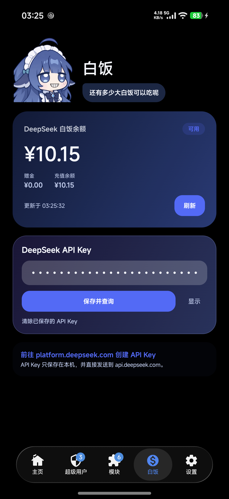
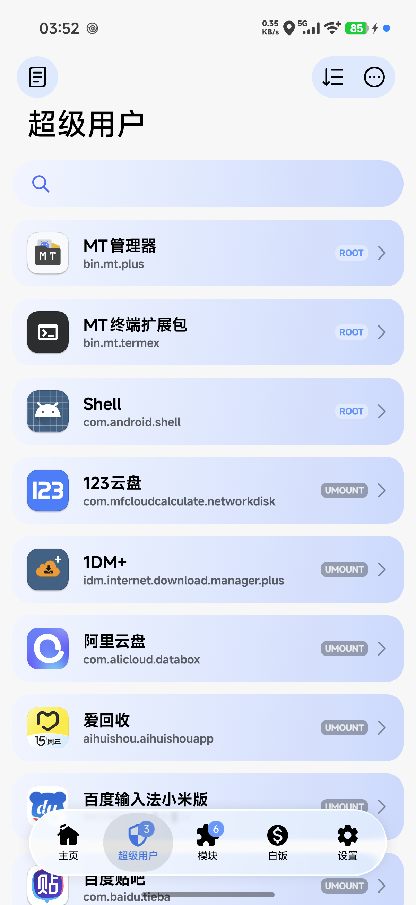
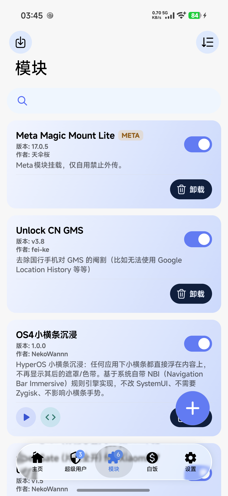

# 大肥鱼KSU

> 非官方 DeepSeek 主题 KernelSU 管理器 + 配套 LKM。  
> 只改 UI 与交互，不改 KernelSU 的 Root / 模块 / 超级用户核心能力。

大肥鱼KSU 基于 **KernelSU v3.3.1**（Manager `32680` / UAPI `5`），使用 Kotlin + Jetpack Compose 重做了管理器界面：DeepSeek 蓝渐变、蓝色大肥鱼毛绒形象、随机语录、设备状态提示，以及一个可以直接查询 DeepSeek 余额的“白饭”页。

> 本项目是社区二创，不代表 DeepSeek 或 KernelSU 官方。  
> 请自行确认设备、内核与刷写风险。

## 下载

### 管理器 APK

| 项目 | 值 |
| --- | --- |
| 版本 | `v3.3.1-baifan.13 (32680-5)` |
| 包名 | `me.weishu.kernelsu` |
| 大小 | `15,214,891` 字节 |
| SHA-256 | `7613876F9D282065C7D3601A2A5C083292062A55A58109E62E5342A274BAEDD4` |
| 签名 | v2-only，自定义证书 |

**[⬇ 下载 APK](https://github.com/NekoWannn/baifan-ksu-lkm/releases/download/v3.3.1-baifan.13/Dafeiyu_KSU_v3.3.1-baifan.13-v2.apk)**

### 配套 LKM

自定义管理器签名需要配套的 `kernelsu.ko`；官方 bundled LKM 不会信任这个 APK。

| KMI | 文件 |
| --- | --- |
| android15-6.6 | [kernelsu-android15-6.6-baifan.ko](https://github.com/NekoWannn/baifan-ksu-lkm/releases/download/v3.3.1-baifan.13/kernelsu-android15-6.6-baifan.ko) |
| android16-6.12 | [kernelsu-android16-6.12-baifan.ko](https://github.com/NekoWannn/baifan-ksu-lkm/releases/download/v3.3.1-baifan.13/kernelsu-android16-6.12-baifan.ko) |
| android17-6.18 | [kernelsu-android17-6.18-baifan.ko](https://github.com/NekoWannn/baifan-ksu-lkm/releases/download/v3.3.1-baifan.13/kernelsu-android17-6.18-baifan.ko) |

## 界面

| 白饭余额 | 超级用户 |
| --- | --- |
|  |  |

| 模块 | 图标 |
| --- | --- |
|  |  |

## 功能

- **DeepSeek 主题 UI**
  - 深蓝渐变背景、圆角卡片、蓝色大肥鱼毛绒形象
  - 首页随机语录 + “换一句”
  - 设备状态提示卡、设备信息卡
- **白饭余额页**
  - 底栏 **白饭**
  - 读取 DeepSeek 官方 `GET https://api.deepseek.com/user/balance`
  - 显示总余额、赠金、充值余额、可用状态、更新时间
  - 支持保存 / 显示 / 清除 API Key、手动刷新、错误提示
  - API Key 只保存在本机 App 私有 SharedPreferences，并排除云备份
- **超级用户 / 模块**
  - 搜索框使用模块卡片同款渐变蓝
  - 顶部按钮圆形浅蓝底；超级用户右上角为胶囊遮罩
  - 模块卡片按钮配色：运行蓝、网页 UI 青、更新琥珀、卸载深蓝
  - 模块开关与“添加模块”按钮使用运行键蓝色
- **免导入 LKM**
  - APK 内置 `android15-6.6` / `android16-6.12` / `android17-6.18` 三个自定义 LKM
  - 安装页默认“LKM（默认内置，可替换）”
  - 按当前内核自动选择并执行 `boot-patch`，流程与官方管理器一致
- **其它**
  - 应用名 **大肥鱼KSU**
  - 关于页渐变剪影图标
  - 屏蔽管理器 / 模块更新检查
  - 关于页 QQ 群：`1077255467`

## 安装

1. 安装 `Dafeiyu_KSU_v3.3.1-baifan.13-v2.apk`。
2. 打开管理器 → 安装。
3. 选择“直接安装”或“选择 boot/init_boot 镜像”。
4. 保持默认的 **LKM（默认内置，可替换）**，点“下一步”。
5. 管理器按内核自动选择内置 LKM 并刷写；重启后确认首页显示“工作中”和 `32680-5`。

> 只有刷其它机型 / 其它 KMI 的镜像时，才需要手动替换本地 `.ko`。  
> 升级管理器不会影响已保存的白饭 API Key；可在白饭页底部清除。

## 构建

### 管理器

需要 JDK 与 Android SDK：

```bash
cd manager
./gradlew :app:assembleRelease -PKSU_NAME="大肥鱼KSU"
```

产物在：

```text
manager/app/build/outputs/apk/release/app-release.apk
```

管理器使用 **v2-only** 签名；仓库内提供 `manager/sign.example.properties` 作为签名配置示例，请使用自己的 keystore。

`manager/app/src/main/jniLibs` 已包含构建所需的预编译 `libksud.so` 等文件。

### LKM

LKM 由 GitHub Actions 构建：

```text
.github/workflows/build-baifan-lkm.yml
```

支持：

- `android15-6.6`
- `android16-6.12`
- `android17-6.18`

## 目录

```text
.github/workflows/    LKM / 管理器构建
kernel/               KernelSU v3.3.1 内核模块
manager/              大肥鱼KSU 管理器源码（Kotlin + Compose）
docs/images/          README 截图
dist/                 本地构建产物（不提交）
```

## 签名

管理器使用自定义 v2-only 证书：

```text
SHA-256: bad08be1f8e813067892adca0e70452cd645ba31e5ed15bec35e60fa430f2f48
DER:     825 bytes (0x0339)
```

LKM 中已嵌入对应公钥摘要；详见 [LKM-README.md](LKM-README.md)。

## 致谢

- [KernelSU](https://github.com/tiann/KernelSU)：内核与管理器基础
- [DeepSeek](https://www.deepseek.com/)：主题灵感与余额接口
- [dafeiyu-persona](https://github.com/ERUIHNIYHBKBNF/dafeiyu-persona)、[deepseek-chan-meme-pack](https://github.com/the-beating-light-of-the-nail/deepseek-chan-meme-pack)：社区语录参考
- 主题作者：**婉彬 & NekoWannn**

## License

KernelSU 及其衍生代码遵循原项目许可证；本仓库中的主题与管理器修改同样按 GPL-3.0 发布。  
DeepSeek 名称、形象与相关素材版权归其权利人所有，本项目仅作非官方社区主题使用。
